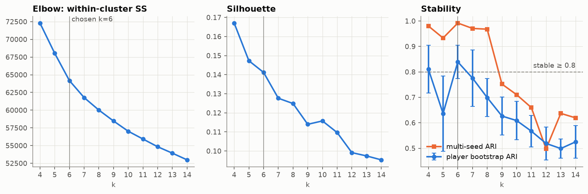
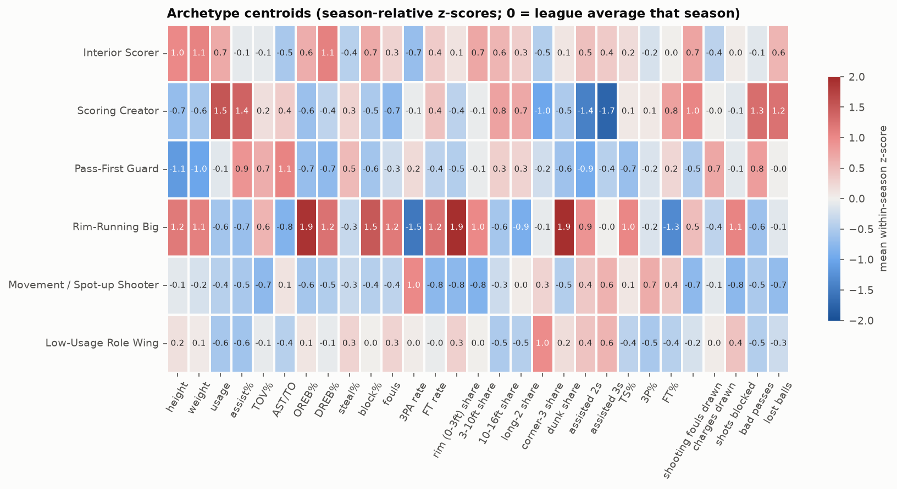
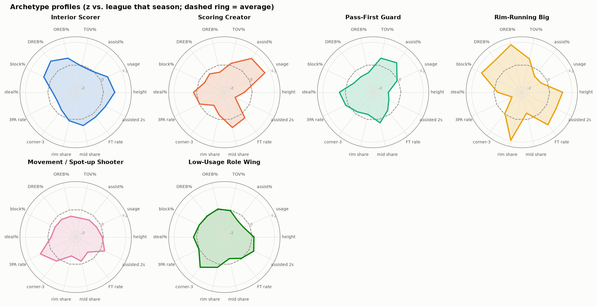
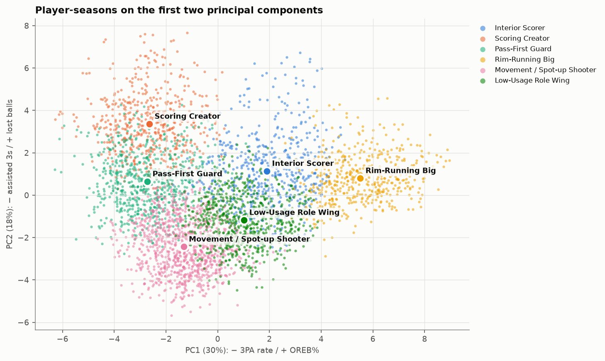
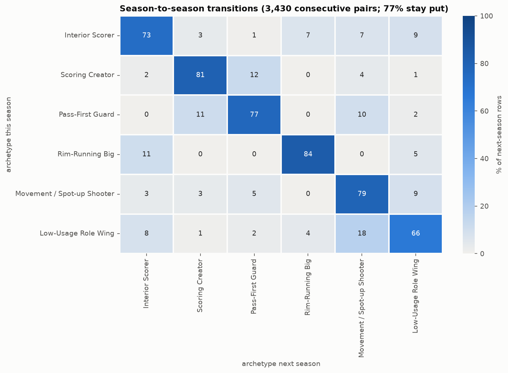
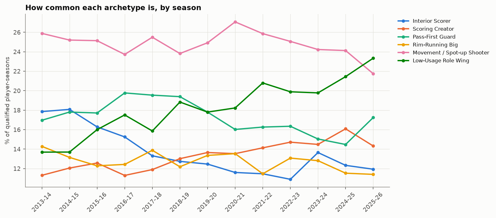

# NBA player archetypes (kaggle)

- Data: Basketball-Reference season tables via the Kaggle export `sumitrodatta/nba-aba-baa-stats` (player_id = B-Ref slug)
- Player-seasons: 4,669 (1,055 players), seasons 2013-14 to 2025-26, filter g>=20 and mp>=500
- Clustering inputs (29 season-relative z-scores): height, weight, usg, ast_pct, tov_pct, ast_to, orb_pct, drb_pct, stl_pct, blk_pct, pf_100, fg3a_rate, fta_rate, rim_share, short_share, mid_share, long2_share, corner3_share, dunk_share, ast_2p, ast_3p, ts, fg3_pct, ft_pct, shoot_foul_drawn_36, charges_36, blocked_rate, bad_pass_36, lost_ball_36
- PCA: 14 components (90.5% variance)
- Not used as inputs (profiling only): per, ws_48, bpm, obpm, dbpm, vorp, o_rtg, d_rtg, on_court_pm, on_off_pm, pos_pg, pos_sg, pos_sf, pos_pf, pos_c, mp, mpg, g, age

## Choosing k

Chosen **k = 6**: the largest k whose player-level bootstrap ARI is >= 0.8 with every cluster >= 2% of rows. Silhouette is low across the board (player styles form a continuum, not separated blobs), so it is a weak guide here; the elbow is gradual. Stability decides.

| k | inertia | silhouette | boot_ari | boot_ari_sd | seed_ari | min_share |
|---|---|---|---|---|---|---|
| 4 | 72299.956 | 0.167 | 0.811 | 0.095 | 0.980 | 0.134 |
| 5 | 68036.449 | 0.147 | 0.636 | 0.148 | 0.933 | 0.135 |
| 6 | 64179.057 | 0.141 | 0.839 | 0.065 | 0.992 | 0.127 |
| 7 | 61779.335 | 0.128 | 0.776 | 0.111 | 0.971 | 0.116 |
| 8 | 60017.797 | 0.125 | 0.699 | 0.075 | 0.968 | 0.087 |
| 9 | 58470.723 | 0.114 | 0.626 | 0.075 | 0.752 | 0.061 |
| 10 | 57025.239 | 0.116 | 0.609 | 0.075 | 0.710 | 0.050 |
| 11 | 55927.013 | 0.110 | 0.567 | 0.062 | 0.660 | 0.057 |
| 12 | 54834.885 | 0.099 | 0.519 | 0.065 | 0.498 | 0.040 |
| 13 | 53929.901 | 0.097 | 0.499 | 0.037 | 0.637 | 0.036 |
| 14 | 52983.920 | 0.095 | 0.525 | 0.064 | 0.620 | 0.039 |

GaussianMixture (full covariance) vs K-Means agreement at k=6: ARI = 0.468.



## Archetypes

Names come from matching each centroid's z-profile to templates written in advance from basketball meaning (config.ARCHETYPE_TEMPLATES); the `profile` column lists the strongest deviations.

| archetype | n | share | mpg | mp | usg | height | fg3a_rate | ast_pct | per | ws_48 | bpm | vorp | on_off_pm | pos_pg | pos_sg | pos_sf | pos_pf | pos_c | profile |
|---|---|---|---|---|---|---|---|---|---|---|---|---|---|---|---|---|---|---|---|
| Interior Scorer | 637 | 0.14 | 26.48 | 1680.88 | 22.88 | 81.92 | 0.21 | 13.72 | 17.99 | 0.12 | 0.97 | 1.48 | 0.96 | 0.35 | 1.73 | 7.36 | 35.39 | 55.23 | +DREB%, +weight, +height, +shooting fouls drawn, -3PA rate, -AST/TO |
| Scoring Creator | 623 | 0.13 | 31.57 | 2017.60 | 27.44 | 76.22 | 0.35 | 27.12 | 18.73 | 0.11 | 2.05 | 2.25 | 2.29 | 46.69 | 29.39 | 16.27 | 7.18 | 0.54 | +usage, +assist%, +bad passes, +lost balls, -assisted 3s, -assisted 2s |
| Pass-First Guard | 805 | 0.17 | 22.72 | 1406.80 | 18.59 | 74.81 | 0.40 | 22.45 | 12.57 | 0.07 | -1.27 | 0.39 | -0.55 | 63.84 | 27.14 | 7.18 | 1.71 | 0.21 | +AST/TO, +assist%, +bad passes, +charges drawn, -height, -weight |
| Rim-Running Big | 593 | 0.13 | 20.80 | 1323.53 | 16.10 | 82.35 | 0.05 | 8.63 | 17.45 | 0.15 | 0.16 | 0.85 | 0.56 | 0.36 | 0.36 | 1.02 | 14.63 | 83.69 | +dunk share, +rim (0-3ft) share, +OREB%, +block%, -3PA rate, -FT% |
| Movement / Spot-up Shooter | 1157 | 0.25 | 23.50 | 1535.15 | 16.93 | 78.19 | 0.56 | 9.74 | 11.97 | 0.08 | -0.92 | 0.53 | -0.14 | 7.55 | 30.31 | 33.74 | 23.28 | 5.23 | +3PA rate, +3P%, +assisted 3s, +FT%, -3-10ft share, -shots blocked |
| Low-Usage Role Wing | 854 | 0.18 | 21.14 | 1325.75 | 16.23 | 79.02 | 0.37 | 9.30 | 11.84 | 0.07 | -1.77 | 0.18 | -0.86 | 2.59 | 17.10 | 35.89 | 34.65 | 9.87 | +corner-3 share, +assisted 3s, +shots blocked, +assisted 2s, -assist%, -usage |







## Are clusters just playing time or quality?

η² = share of a variable's variance explained by archetype membership (0 = unrelated, 1 = determined).

| variable | η² |
|---|---|
| mp | 0.128 |
| mpg | 0.232 |
| usg | 0.523 |
| bpm | 0.219 |
| ws_48 | 0.243 |
| vorp | 0.235 |
| height | 0.599 |

Read mp/mpg η² as 'how much archetype is a minutes proxy'; bpm/ws_48/vorp were never inputs and show how much the style groups differ in value.

## Movement between seasons

77% of consecutive player-season pairs keep the same archetype.





## Representatives (closest to centroid) and most ambiguous players

- **Interior Scorer**: Jon Leuer (2015-16), Markieff Morris (2013-14), Christian Wood (2022-23), Henry Sims (2014-15), Bobby Portis (2017-18), Nikola Vučević (2014-15), Michael Beasley (2013-14), Kris Humphries (2016-17)
  - borderline: Giannis Antetokounmpo (2018-19, vs Rim-Running Big), Dillon Brooks (2021-22, vs Scoring Creator), Nenê (2018-19, vs Rim-Running Big), Aleksej Pokusevski (2021-22, vs Low-Usage Role Wing), Rudy Gay (2021-22, vs Low-Usage Role Wing)
- **Scoring Creator**: Bradley Beal (2018-19), Eric Bledsoe (2019-20), Donovan Mitchell (2025-26), Khris Middleton (2018-19), Jordan Clarkson (2014-15), Desmond Bane (2023-24), Bradley Beal (2017-18), Donovan Mitchell (2019-20)
  - borderline: Kevin Durant (2024-25, vs Interior Scorer), Ish Smith (2015-16, vs Pass-First Guard), CJ McCollum (2018-19, vs Pass-First Guard), Emmanuel Mudiay (2017-18, vs Pass-First Guard), Gerald Green (2014-15, vs Movement / Spot-up Shooter)
- **Pass-First Guard**: Raymond Felton (2016-17), Goran Dragić (2018-19), Cameron Payne (2018-19), Goran Dragić (2015-16), Raymond Felton (2013-14), Aaron Holiday (2019-20), Cory Joseph (2016-17), Reggie Jackson (2023-24)
  - borderline: Derek Fisher (2013-14, vs Movement / Spot-up Shooter), Joe Ingles (2014-15, vs Movement / Spot-up Shooter), Isaiah Canaan (2016-17, vs Movement / Spot-up Shooter), Tony Parker (2013-14, vs Scoring Creator), Evan Turner (2013-14, vs Interior Scorer)
- **Rim-Running Big**: Ian Mahinmi (2015-16), Gorgui Dieng (2013-14), Drew Eubanks (2020-21), Bismack Biyombo (2017-18), Mark Williams (2022-23), Jalen Duren (2022-23), Ed Davis (2017-18), Tony Bradley (2020-21)
  - borderline: Jock Landale (2023-24, vs Interior Scorer), Usman Garuba (2022-23, vs Low-Usage Role Wing), Cody Zeller (2014-15, vs Interior Scorer), Zion Williamson (2025-26, vs Interior Scorer), Moritz Wagner (2023-24, vs Interior Scorer)
- **Movement / Spot-up Shooter**: Cameron Johnson (2023-24), Moses Moody (2025-26), Chase Budinger (2013-14), Terrence Ross (2013-14), Hollis Thompson (2014-15), Cartier Martin (2013-14), Simone Fontecchio (2025-26), Furkan Korkmaz (2019-20)
  - borderline: Josh Green (2024-25, vs Low-Usage Role Wing), Donte DiVincenzo (2022-23, vs Pass-First Guard), Patty Mills (2022-23, vs Pass-First Guard), Omri Casspi (2015-16, vs Low-Usage Role Wing), Evan Fournier (2019-20, vs Scoring Creator)
- **Low-Usage Role Wing**: Jaylen Brown (2016-17), James Ennis III (2019-20), Jalen McDaniels (2020-21), CJ Elleby (2021-22), Taylor Hendricks (2025-26), Jake LaRavia (2025-26), Jalen McDaniels (2022-23), Dorian Finney-Smith (2018-19)
  - borderline: Robert Covington (2019-20, vs Movement / Spot-up Shooter), Dante Cunningham (2014-15, vs Movement / Spot-up Shooter), Matisse Thybulle (2022-23, vs Movement / Spot-up Shooter), Mario Hezonja (2016-17, vs Movement / Spot-up Shooter), Charlie Villanueva (2015-16, vs Movement / Spot-up Shooter)

## Post-hoc sanity check (famous players; never used to fit or name clusters)

| player_name | 2013-14 | 2014-15 | 2015-16 | 2016-17 | 2017-18 | 2018-19 | 2019-20 | 2020-21 | 2021-22 | 2022-23 | 2023-24 | 2024-25 | 2025-26 |
|---|---|---|---|---|---|---|---|---|---|---|---|---|---|
| Brook Lopez | · | Interior Scorer | Interior Scorer | Interior Scorer | Interior Scorer | Movement / Spot-up Shooter | Interior Scorer | Interior Scorer | · | Interior Scorer | Interior Scorer | Interior Scorer | Interior Scorer |
| Chris Paul | Scoring Creator | Scoring Creator | Scoring Creator | Scoring Creator | Scoring Creator | Scoring Creator | Scoring Creator | Scoring Creator | Scoring Creator | Pass-First Guard | Pass-First Guard | Pass-First Guard | · |
| Clint Capela | · | · | Rim-Running Big | Rim-Running Big | Rim-Running Big | Rim-Running Big | Rim-Running Big | Rim-Running Big | Rim-Running Big | Rim-Running Big | Rim-Running Big | Rim-Running Big | Rim-Running Big |
| DeMar DeRozan | Scoring Creator | Scoring Creator | Scoring Creator | Scoring Creator | Scoring Creator | Scoring Creator | Scoring Creator | Scoring Creator | Scoring Creator | Scoring Creator | Scoring Creator | Scoring Creator | Scoring Creator |
| Draymond Green | Low-Usage Role Wing | Low-Usage Role Wing | Interior Scorer | Pass-First Guard | Pass-First Guard | Pass-First Guard | Pass-First Guard | Pass-First Guard | Interior Scorer | Low-Usage Role Wing | Pass-First Guard | Low-Usage Role Wing | Pass-First Guard |
| Giannis Antetokounmpo | Low-Usage Role Wing | Interior Scorer | Interior Scorer | Interior Scorer | Interior Scorer | Interior Scorer | Interior Scorer | Interior Scorer | Interior Scorer | Interior Scorer | Interior Scorer | Interior Scorer | Interior Scorer |
| Klay Thompson | Movement / Spot-up Shooter | Movement / Spot-up Shooter | Movement / Spot-up Shooter | Movement / Spot-up Shooter | Movement / Spot-up Shooter | Movement / Spot-up Shooter | · | · | Movement / Spot-up Shooter | Movement / Spot-up Shooter | Movement / Spot-up Shooter | Movement / Spot-up Shooter | Movement / Spot-up Shooter |
| LeBron James | Scoring Creator | Scoring Creator | Scoring Creator | Scoring Creator | Scoring Creator | Scoring Creator | Scoring Creator | Scoring Creator | Scoring Creator | Scoring Creator | Scoring Creator | Scoring Creator | Scoring Creator |
| Nikola Jokić | · | · | Interior Scorer | Interior Scorer | Interior Scorer | Interior Scorer | Interior Scorer | Interior Scorer | Interior Scorer | Interior Scorer | Interior Scorer | Interior Scorer | Interior Scorer |
| P.J. Tucker | Low-Usage Role Wing | Low-Usage Role Wing | Low-Usage Role Wing | Low-Usage Role Wing | Movement / Spot-up Shooter | Movement / Spot-up Shooter | Movement / Spot-up Shooter | Low-Usage Role Wing | Movement / Spot-up Shooter | Movement / Spot-up Shooter | · | · | · |
| Rudy Gobert | · | Rim-Running Big | Rim-Running Big | Rim-Running Big | Rim-Running Big | Rim-Running Big | Rim-Running Big | Rim-Running Big | Rim-Running Big | Rim-Running Big | Rim-Running Big | Rim-Running Big | Rim-Running Big |
| Stephen Curry | Scoring Creator | Scoring Creator | Scoring Creator | Scoring Creator | Scoring Creator | Scoring Creator | · | Scoring Creator | Scoring Creator | Scoring Creator | Scoring Creator | Scoring Creator | Scoring Creator |

## Pipeline log

```
== features: 4,669 player-seasons
  shrink fg3_pct: k=100 pseudo-attempts, 167 zero-attempt NaNs set to the season mean
  shrink ft_pct: k=50 pseudo-attempts, 0 zero-attempt NaNs set to the season mean
  shrink ast_2p: k=40 pseudo-attempts, 0 zero-attempt NaNs set to the season mean
  shrink ast_3p: k=25 pseudo-attempts, 421 zero-attempt NaNs set to the season mean
  shrink corner3_share: k=40 pseudo-attempts, 167 zero-attempt NaNs set to the season mean
  corr prune: drop avg_shot_dist (|r|=0.93 with fg3a_rate)
  corr prune: drop pts_100 (|r|=0.95 with usg)
  corr prune: drop fga_100 (|r|=0.97 with usg)
  final features (29): height, weight, usg, ast_pct, tov_pct, ast_to, orb_pct, drb_pct, stl_pct, blk_pct, pf_100, fg3a_rate, fta_rate, rim_share, short_share, mid_share, long2_share, corner3_share, dunk_share, ast_2p, ast_3p, ts, fg3_pct, ft_pct, shoot_foul_drawn_36, charges_36, blocked_rate, bad_pass_36, lost_ball_36
== model
  PCA: 14 components keep 90.5% of variance (from 29 features)
  k= 4 inertia=    72300 silhouette=0.167 bootstrap ARI=0.811±0.095 multi-seed ARI=0.980 smallest=13.4%
  k= 5 inertia=    68036 silhouette=0.147 bootstrap ARI=0.636±0.148 multi-seed ARI=0.933 smallest=13.5%
  k= 6 inertia=    64179 silhouette=0.141 bootstrap ARI=0.839±0.065 multi-seed ARI=0.992 smallest=12.7%
  k= 7 inertia=    61779 silhouette=0.128 bootstrap ARI=0.776±0.111 multi-seed ARI=0.971 smallest=11.6%
  k= 8 inertia=    60018 silhouette=0.125 bootstrap ARI=0.699±0.075 multi-seed ARI=0.968 smallest=8.7%
  k= 9 inertia=    58471 silhouette=0.114 bootstrap ARI=0.626±0.075 multi-seed ARI=0.752 smallest=6.1%
  k=10 inertia=    57025 silhouette=0.116 bootstrap ARI=0.609±0.075 multi-seed ARI=0.710 smallest=5.0%
  k=11 inertia=    55927 silhouette=0.110 bootstrap ARI=0.567±0.062 multi-seed ARI=0.660 smallest=5.7%
  k=12 inertia=    54835 silhouette=0.099 bootstrap ARI=0.519±0.065 multi-seed ARI=0.498 smallest=4.0%
  k=13 inertia=    53930 silhouette=0.097 bootstrap ARI=0.499±0.037 multi-seed ARI=0.637 smallest=3.6%
  k=14 inertia=    52984 silhouette=0.095 bootstrap ARI=0.525±0.064 multi-seed ARI=0.620 smallest=3.9%
  chosen k=6: largest k with bootstrap ARI >= 0.8 and every cluster >= 2% of rows
  final KMeans k=6; GaussianMixture(full) agreement ARI=0.468
  cluster 0: best template 'Interior Scorer' cos=0.93 -> 'Interior Scorer' | +DREB%, +weight, +height, +shooting fouls drawn, -3PA rate, -AST/TO
  cluster 1: best template 'Scoring Creator' cos=0.95 -> 'Scoring Creator' | +usage, +assist%, +bad passes, +lost balls, -assisted 3s, -assisted 2s
  cluster 2: best template 'Pass-First Guard' cos=0.97 -> 'Pass-First Guard' | +AST/TO, +assist%, +bad passes, +charges drawn, -height, -weight
  cluster 3: best template 'Rim-Running Big' cos=0.99 -> 'Rim-Running Big' | +dunk share, +rim (0-3ft) share, +OREB%, +block%, -3PA rate, -FT%
  cluster 4: best template 'Movement / Spot-up Shooter' cos=0.98 -> 'Movement / Spot-up Shooter' | +3PA rate, +3P%, +assisted 3s, +FT%, -3-10ft share, -shots blocked
  cluster 5: best template 'Low-Usage Role Wing' cos=0.97 -> 'Low-Usage Role Wing' | +corner-3 share, +assisted 3s, +shots blocked, +assisted 2s, -assist%, -usage
== report
```
