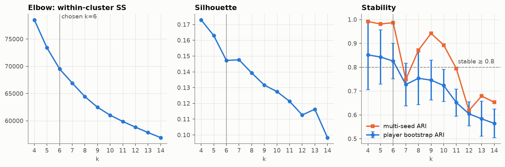
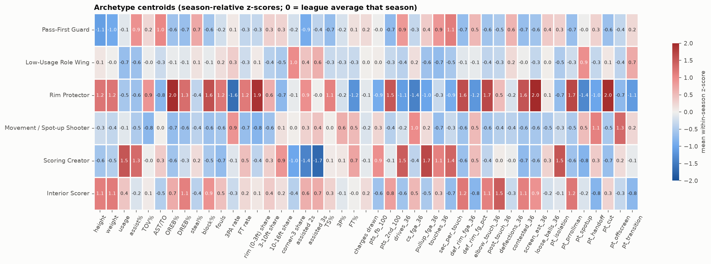
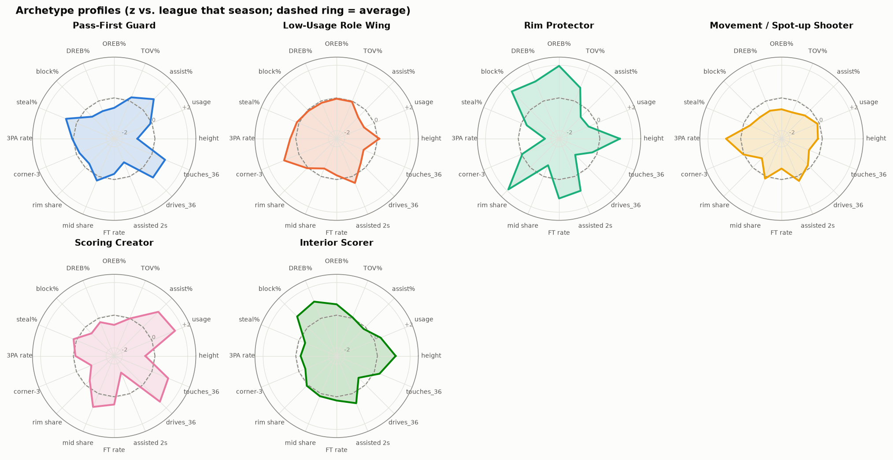
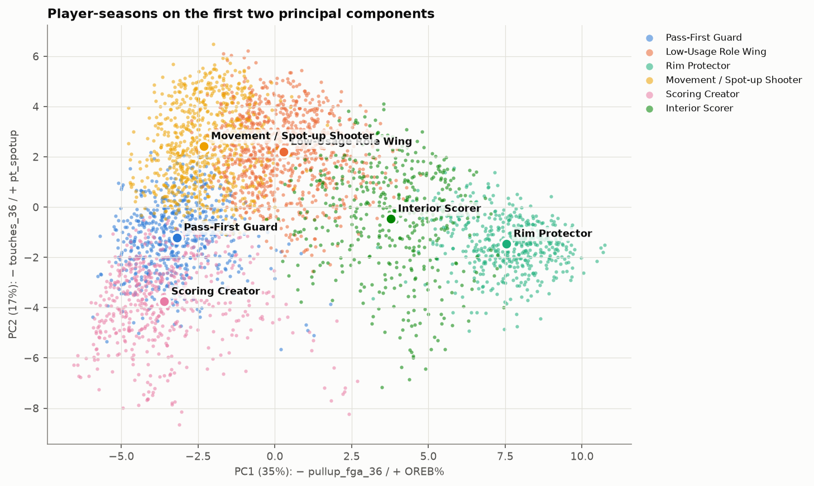
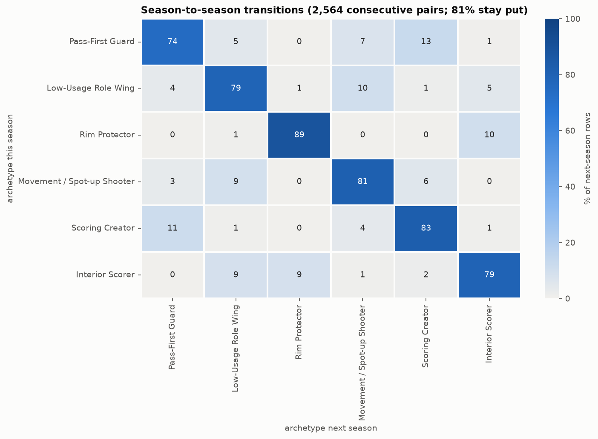
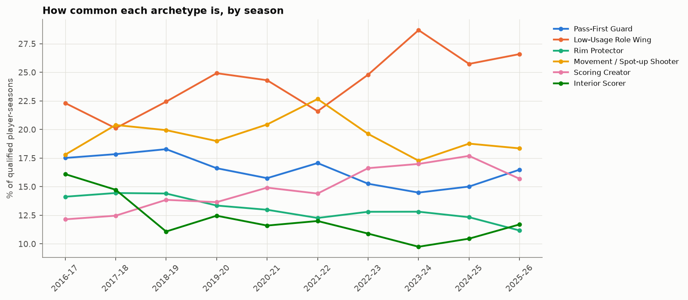

# NBA player archetypes (nba_api)

- Data: stats.nba.com via `nba_api` (player_id = NBA PLAYER_ID); WS/48/BPM/VORP joined from the Kaggle export by (season, normalised name)
- Player-seasons: 3,617 (898 players), seasons 2016-17 to 2025-26, filter g>=20 and mp>=500
- Clustering inputs (45 season-relative z-scores): height, weight, usg, ast_pct, tov_pct, ast_to, orb_pct, drb_pct, stl_pct, blk_pct, pf_100, fg3a_rate, fta_rate, rim_share, short_share, mid_share, corner3_share, ast_2p, ast_3p, ts, fg3_pct, ft_pct, charges_36, pts_fb_100, pts_2nd_100, drives_36, cs_fga_36, pullup_fga_36, touches_36, sec_per_touch, def_rim_fga_36, def_rim_fg_pct, elbow_touch_36, post_touch_36, deflections_36, contested_36, screen_ast_36, loose_balls_36, pt_isolation, pt_prrollman, pt_spotup, pt_handoff, pt_cut, pt_offscreen, pt_transition
- PCA: 18 components (90.8% variance)
- Not used as inputs (profiling only): per, ws_48, bpm, obpm, dbpm, vorp, o_rtg, d_rtg, net_rating, on_court_pm, on_off_pm, pie, pos_pg, pos_sg, pos_sf, pos_pf, pos_c, mp, mpg, g, age

## Choosing k

Chosen **k = 6**: the largest k whose player-level bootstrap ARI is >= 0.8 with every cluster >= 2% of rows. Silhouette is low across the board (player styles form a continuum, not separated blobs), so it is a weak guide here; the elbow is gradual. Stability decides.

| k | inertia | silhouette | boot_ari | boot_ari_sd | seed_ari | min_share |
|---|---|---|---|---|---|---|
| 4 | 78523.163 | 0.173 | 0.852 | 0.147 | 0.992 | 0.207 |
| 5 | 73398.281 | 0.163 | 0.843 | 0.114 | 0.981 | 0.126 |
| 6 | 69509.490 | 0.147 | 0.826 | 0.075 | 0.987 | 0.120 |
| 7 | 66920.607 | 0.148 | 0.727 | 0.089 | 0.749 | 0.060 |
| 8 | 64429.520 | 0.139 | 0.754 | 0.110 | 0.871 | 0.052 |
| 9 | 62474.304 | 0.132 | 0.746 | 0.083 | 0.942 | 0.051 |
| 10 | 61022.899 | 0.127 | 0.723 | 0.067 | 0.893 | 0.036 |
| 11 | 59868.261 | 0.121 | 0.652 | 0.057 | 0.794 | 0.034 |
| 12 | 58817.800 | 0.113 | 0.604 | 0.051 | 0.618 | 0.032 |
| 13 | 57834.434 | 0.116 | 0.584 | 0.073 | 0.679 | 0.028 |
| 14 | 56901.257 | 0.098 | 0.564 | 0.060 | 0.653 | 0.026 |

GaussianMixture (full covariance) vs K-Means agreement at k=6: ARI = 0.429.



## Archetypes

Names come from matching each centroid's z-profile to templates written in advance from basketball meaning (config.ARCHETYPE_TEMPLATES); the `profile` column lists the strongest deviations.

| archetype | n | share | mpg | mp | usg | height | fg3a_rate | ast_pct | per | ws_48 | bpm | vorp | on_off_pm | pos_pg | pos_sg | pos_sf | pos_pf | pos_c | profile |
|---|---|---|---|---|---|---|---|---|---|---|---|---|---|---|---|---|---|---|---|
| Pass-First Guard | 594 | 0.16 | 22.61 | 1391.29 | 0.18 | 75.09 | 0.40 | 0.23 | 12.65 | 0.07 | -1.27 | 0.40 | -0.43 | 64.42 | 26.27 | 7.85 | 1.47 | 0.08 | +sec_per_touch, +AST/TO, +assist%, +touches_36, -height, -weight |
| Low-Usage Role Wing | 874 | 0.24 | 21.62 | 1339.15 | 0.15 | 78.93 | 0.46 | 0.09 | 11.48 | 0.08 | -1.60 | 0.24 | -0.47 | 3.14 | 16.79 | 36.28 | 38.26 | 5.65 | +corner-3 share, +pt_spotup, +pt_transition, +assisted 3s, -touches_36, -usage |
| Rim Protector | 472 | 0.13 | 20.71 | 1289.47 | 0.16 | 82.56 | 0.05 | 0.09 | 17.79 | 0.15 | 0.26 | 0.88 | 0.51 | 0.05 | 0.16 | 0.30 | 9.39 | 90.16 | +screen_ast_36, +OREB%, +pt_cut, +rim (0-3ft) share, -3PA rate, -cs_fga_36 |
| Movement / Spot-up Shooter | 703 | 0.19 | 24.49 | 1564.47 | 0.18 | 77.70 | 0.57 | 0.11 | 12.25 | 0.08 | -1.24 | 0.43 | -0.51 | 9.84 | 37.55 | 34.94 | 16.73 | 1.04 | +pt_offscreen, +pt_handoff, +cs_fga_36, +3PA rate, -rim (0-3ft) share, -TOV% |
| Scoring Creator | 538 | 0.15 | 31.67 | 1987.66 | 0.27 | 76.65 | 0.36 | 0.26 | 18.91 | 0.12 | 2.16 | 2.27 | 2.19 | 43.49 | 26.30 | 16.07 | 12.61 | 1.59 | +pullup_fga_36, +pt_isolation, +usage, +drives_36, -assisted 3s, -assisted 2s |
| Interior Scorer | 436 | 0.12 | 24.61 | 1543.84 | 0.21 | 82.28 | 0.32 | 0.13 | 17.55 | 0.13 | 1.15 | 1.43 | 0.87 | 0.01 | 0.28 | 1.96 | 32.92 | 64.91 | +post_touch_36, +pt_prrollman, +def_rim_fga_36, +weight, -pt_handoff, -def_rim_fg_pct |







## Are clusters just playing time or quality?

η² = share of a variable's variance explained by archetype membership (0 = unrelated, 1 = determined).

| variable | η² |
|---|---|
| mp | 0.134 |
| mpg | 0.242 |
| usg | 0.525 |
| bpm | 0.249 |
| ws_48 | 0.282 |
| vorp | 0.256 |
| height | 0.602 |

Read mp/mpg η² as 'how much archetype is a minutes proxy'; bpm/ws_48/vorp were never inputs and show how much the style groups differ in value.

## Movement between seasons

81% of consecutive player-season pairs keep the same archetype.





## Representatives (closest to centroid) and most ambiguous players

- **Pass-First Guard**: Andrew Nembhard (2023-24), Aaron Holiday (2019-20), Andrew Nembhard (2022-23), Raul Neto (2019-20), Raymond Felton (2016-17), Cameron Payne (2018-19), Cory Joseph (2016-17), Elie Okobo (2019-20)
  - borderline: RJ Barrett (2021-22, vs Movement / Spot-up Shooter), De'Anthony Melton (2022-23, vs Low-Usage Role Wing), Joe Ingles (2018-19, vs Movement / Spot-up Shooter), Tyrese Maxey (2021-22, vs Scoring Creator), Jalen Brunson (2021-22, vs Scoring Creator)
- **Low-Usage Role Wing**: Torrey Craig (2021-22), Dorian Finney-Smith (2018-19), Yuta Watanabe (2020-21), Oshae Brissett (2021-22), Cedi Osman (2017-18), CJ Elleby (2021-22), Jalen McDaniels (2021-22), Obi Toppin (2020-21)
  - borderline: Kyle Kuzma (2017-18, vs Movement / Spot-up Shooter), Terry Taylor (2021-22, vs Rim Protector), Davon Reed (2021-22, vs Movement / Spot-up Shooter), Cedi Osman (2020-21, vs Movement / Spot-up Shooter), Jahmai Mashack (2025-26, vs Pass-First Guard)
- **Rim Protector**: Khem Birch (2017-18), Richaun Holmes (2023-24), Jalen Duren (2022-23), Dewayne Dedmon (2016-17), Moussa Diabaté (2025-26), Alex Len (2019-20), Bismack Biyombo (2019-20), Drew Eubanks (2020-21)
  - borderline: Rondae Hollis-Jefferson (2019-20, vs Low-Usage Role Wing), Larry Nance Jr. (2018-19, vs Interior Scorer), Timofey Mozgov (2016-17, vs Interior Scorer), Zion Williamson (2019-20, vs Interior Scorer), Xavier Tillman (2020-21, vs Interior Scorer)
- **Movement / Spot-up Shooter**: Cameron Johnson (2023-24), Kevin Huerter (2021-22), Furkan Korkmaz (2020-21), Julian Strawther (2025-26), Tyler Johnson (2017-18), Landry Shamet (2020-21), Gerald Green (2016-17), Malik Beasley (2019-20)
  - borderline: Anthony Tolliver (2017-18, vs Low-Usage Role Wing), Desmond Bane (2022-23, vs Scoring Creator), Kyle Kuzma (2024-25, vs Low-Usage Role Wing), Joe Johnson (2017-18, vs Low-Usage Role Wing), Payton Pritchard (2022-23, vs Pass-First Guard)
- **Scoring Creator**: Donovan Mitchell (2025-26), Donovan Mitchell (2024-25), Donovan Mitchell (2019-20), Malcolm Brogdon (2021-22), Bradley Beal (2017-18), D'Angelo Russell (2020-21), Emmanuel Mudiay (2018-19), De'Aaron Fox (2024-25)
  - borderline: Kemba Walker (2021-22, vs Pass-First Guard), Dennis Schröder (2024-25, vs Pass-First Guard), Isaiah Collier (2025-26, vs Pass-First Guard), Danilo Gallinari (2018-19, vs Movement / Spot-up Shooter), Sharife Cooper (2025-26, vs Pass-First Guard)
- **Interior Scorer**: Kris Humphries (2016-17), Christian Wood (2022-23), Dario Saric (2019-20), Wendell Carter Jr. (2022-23), Wendell Carter Jr. (2021-22), Trey Lyles (2021-22), Omari Spellman (2019-20), Christian Wood (2020-21)
  - borderline: Domantas Sabonis (2024-25, vs Rim Protector), Greg Monroe (2016-17, vs Rim Protector), Carmelo Anthony (2019-20, vs Movement / Spot-up Shooter), Aaron Gordon (2024-25, vs Low-Usage Role Wing), Anthony Gill (2025-26, vs Rim Protector)

## Post-hoc sanity check (famous players; never used to fit or name clusters)

| player_name | 2016-17 | 2017-18 | 2018-19 | 2019-20 | 2020-21 | 2021-22 | 2022-23 | 2023-24 | 2024-25 | 2025-26 |
|---|---|---|---|---|---|---|---|---|---|---|
| Brook Lopez | Interior Scorer | Interior Scorer | Interior Scorer | Interior Scorer | Interior Scorer | · | Interior Scorer | Interior Scorer | Interior Scorer | Interior Scorer |
| Chris Paul | Scoring Creator | Scoring Creator | Scoring Creator | Scoring Creator | Scoring Creator | Scoring Creator | Scoring Creator | Pass-First Guard | Pass-First Guard | · |
| Clint Capela | Rim Protector | Rim Protector | Rim Protector | Rim Protector | Rim Protector | Rim Protector | Rim Protector | Rim Protector | Rim Protector | Rim Protector |
| DeMar DeRozan | Scoring Creator | Scoring Creator | Scoring Creator | Scoring Creator | Scoring Creator | Scoring Creator | Scoring Creator | Scoring Creator | Scoring Creator | Scoring Creator |
| Draymond Green | Interior Scorer | Interior Scorer | Low-Usage Role Wing | Interior Scorer | Interior Scorer | Interior Scorer | Interior Scorer | Interior Scorer | Interior Scorer | Interior Scorer |
| Giannis Antetokounmpo | Scoring Creator | Scoring Creator | Scoring Creator | Scoring Creator | Scoring Creator | Scoring Creator | Scoring Creator | Scoring Creator | Scoring Creator | Interior Scorer |
| Klay Thompson | Movement / Spot-up Shooter | Movement / Spot-up Shooter | Movement / Spot-up Shooter | · | · | Movement / Spot-up Shooter | Movement / Spot-up Shooter | Movement / Spot-up Shooter | Movement / Spot-up Shooter | Movement / Spot-up Shooter |
| LeBron James | Scoring Creator | Scoring Creator | Scoring Creator | Scoring Creator | Scoring Creator | Scoring Creator | Scoring Creator | Scoring Creator | Scoring Creator | Scoring Creator |
| Nikola Jokić | Interior Scorer | Interior Scorer | Interior Scorer | Interior Scorer | Interior Scorer | Interior Scorer | Interior Scorer | Interior Scorer | Interior Scorer | Interior Scorer |
| P.J. Tucker | Low-Usage Role Wing | Low-Usage Role Wing | Low-Usage Role Wing | Low-Usage Role Wing | Low-Usage Role Wing | Low-Usage Role Wing | Low-Usage Role Wing | · | · | · |
| Rudy Gobert | Rim Protector | Rim Protector | Rim Protector | Rim Protector | Rim Protector | Rim Protector | Rim Protector | Rim Protector | Rim Protector | Rim Protector |
| Stephen Curry | Scoring Creator | Scoring Creator | Scoring Creator | · | Scoring Creator | Scoring Creator | Scoring Creator | Scoring Creator | Scoring Creator | Scoring Creator |

## Pipeline log

```
== ingest (nba_api)
== features: 3,617 player-seasons
  shrink fg3_pct: k=100 pseudo-attempts, 93 zero-attempt NaNs set to the season mean
  shrink ft_pct: k=50 pseudo-attempts, 0 zero-attempt NaNs set to the season mean
  shrink ast_2p: k=40 pseudo-attempts, 0 zero-attempt NaNs set to the season mean
  shrink ast_3p: k=25 pseudo-attempts, 0 zero-attempt NaNs set to the season mean
  shrink corner3_share: k=40 pseudo-attempts, 121 zero-attempt NaNs set to the season mean
  shrink def_rim_fg_pct: k=60 pseudo-attempts, 0 zero-attempt NaNs set to the season mean
  impute weight: 2 rows (0.1%) set to the season median
  impute pt_isolation: 32 rows (0.9%) set to the season median
  impute pt_prballhandler: 32 rows (0.9%) set to the season median
  impute pt_prrollman: 32 rows (0.9%) set to the season median
  impute pt_postup: 32 rows (0.9%) set to the season median
  impute pt_spotup: 32 rows (0.9%) set to the season median
  impute pt_handoff: 32 rows (0.9%) set to the season median
  impute pt_cut: 32 rows (0.9%) set to the season median
  impute pt_offscreen: 32 rows (0.9%) set to the season median
  impute pt_transition: 32 rows (0.9%) set to the season median
  impute pt_offrebound: 32 rows (0.9%) set to the season median
  corr prune: drop pts_100 (|r|=0.95 with usg)
  corr prune: drop fga_100 (|r|=0.97 with usg)
  corr prune: drop pts_paint_share (|r|=0.91 with rim_share)
  corr prune: drop drib_per_touch (|r|=0.97 with sec_per_touch)
  corr prune: drop passes_36 (|r|=0.94 with touches_36)
  corr prune: drop potential_ast_36 (|r|=0.98 with ast_pct)
  corr prune: drop reb_chances_36 (|r|=0.92 with orb_pct)
  corr prune: drop paint_touch_36 (|r|=0.94 with orb_pct)
  corr prune: drop pt_prballhandler (|r|=0.90 with sec_per_touch)
  corr prune: drop pt_postup (|r|=0.93 with post_touch_36)
  corr prune: drop pt_offrebound (|r|=0.92 with orb_pct)
  final features (45): height, weight, usg, ast_pct, tov_pct, ast_to, orb_pct, drb_pct, stl_pct, blk_pct, pf_100, fg3a_rate, fta_rate, rim_share, short_share, mid_share, corner3_share, ast_2p, ast_3p, ts, fg3_pct, ft_pct, charges_36, pts_fb_100, pts_2nd_100, drives_36, cs_fga_36, pullup_fga_36, touches_36, sec_per_touch, def_rim_fga_36, def_rim_fg_pct, elbow_touch_36, post_touch_36, deflections_36, contested_36, screen_ast_36, loose_balls_36, pt_isolation, pt_prrollman, pt_spotup, pt_handoff, pt_cut, pt_offscreen, pt_transition
== model
  PCA: 18 components keep 90.8% of variance (from 45 features)
  k= 4 inertia=    78523 silhouette=0.173 bootstrap ARI=0.852±0.147 multi-seed ARI=0.992 smallest=20.7%
  k= 5 inertia=    73398 silhouette=0.163 bootstrap ARI=0.843±0.114 multi-seed ARI=0.981 smallest=12.6%
  k= 6 inertia=    69509 silhouette=0.147 bootstrap ARI=0.826±0.075 multi-seed ARI=0.987 smallest=12.0%
  k= 7 inertia=    66921 silhouette=0.148 bootstrap ARI=0.727±0.089 multi-seed ARI=0.749 smallest=6.0%
  k= 8 inertia=    64430 silhouette=0.139 bootstrap ARI=0.754±0.110 multi-seed ARI=0.871 smallest=5.2%
  k= 9 inertia=    62474 silhouette=0.132 bootstrap ARI=0.746±0.083 multi-seed ARI=0.942 smallest=5.1%
  k=10 inertia=    61023 silhouette=0.127 bootstrap ARI=0.723±0.067 multi-seed ARI=0.893 smallest=3.6%
  k=11 inertia=    59868 silhouette=0.121 bootstrap ARI=0.652±0.057 multi-seed ARI=0.794 smallest=3.4%
  k=12 inertia=    58818 silhouette=0.113 bootstrap ARI=0.604±0.051 multi-seed ARI=0.618 smallest=3.2%
  k=13 inertia=    57834 silhouette=0.116 bootstrap ARI=0.584±0.073 multi-seed ARI=0.679 smallest=2.8%
  k=14 inertia=    56901 silhouette=0.098 bootstrap ARI=0.564±0.060 multi-seed ARI=0.653 smallest=2.6%
  chosen k=6: largest k with bootstrap ARI >= 0.8 and every cluster >= 2% of rows
  final KMeans k=6; GaussianMixture(full) agreement ARI=0.429
  cluster 0: best template 'Pass-First Guard' cos=0.99 -> 'Pass-First Guard' | +sec_per_touch, +AST/TO, +assist%, +touches_36, -height, -weight
  cluster 1: best template 'Low-Usage Role Wing' cos=0.98 -> 'Low-Usage Role Wing' | +corner-3 share, +pt_spotup, +pt_transition, +assisted 3s, -touches_36, -usage
  cluster 2: best template 'Rim Protector' cos=0.97 -> 'Rim Protector' | +screen_ast_36, +OREB%, +pt_cut, +rim (0-3ft) share, -3PA rate, -cs_fga_36
  cluster 3: best template 'Movement / Spot-up Shooter' cos=0.89 -> 'Movement / Spot-up Shooter' | +pt_offscreen, +pt_handoff, +cs_fga_36, +3PA rate, -rim (0-3ft) share, -TOV%
  cluster 4: best template 'Scoring Creator' cos=0.97 -> 'Scoring Creator' | +pullup_fga_36, +pt_isolation, +usage, +drives_36, -assisted 3s, -assisted 2s
  cluster 5: best template 'Interior Scorer' cos=0.89 -> 'Interior Scorer' | +post_touch_36, +pt_prrollman, +def_rim_fga_36, +weight, -pt_handoff, -def_rim_fg_pct
== report
```
